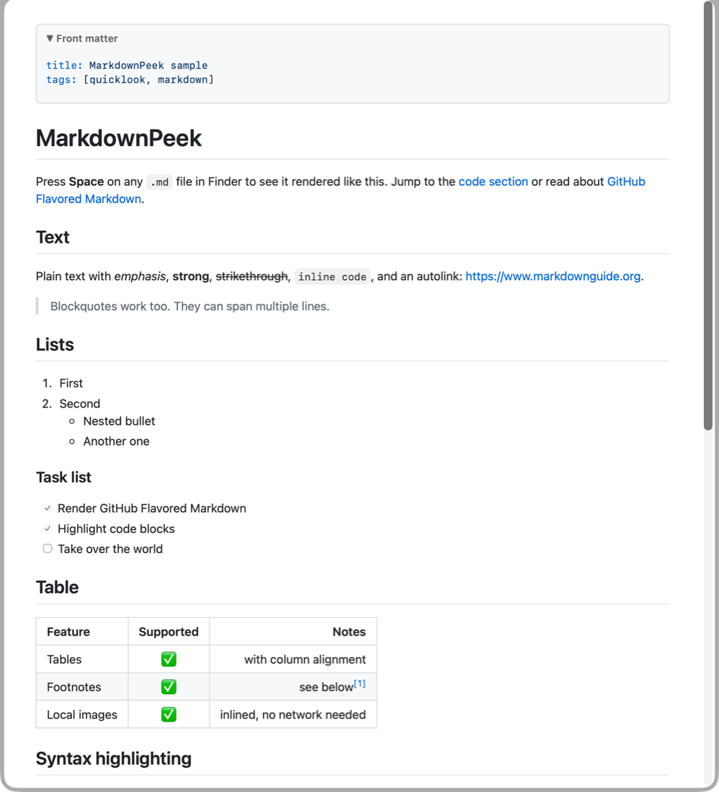
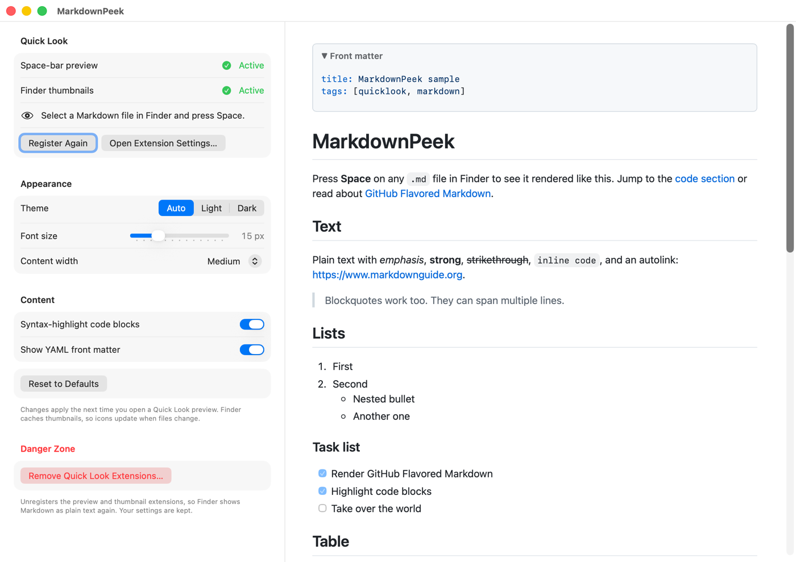

# MarkdownPeek

Quick Look for Markdown on macOS. Select a `.md` file in Finder and press **Space** to see it rendered: GitHub Flavored Markdown, syntax-highlighted code, light and dark mode. Finder icons show a rendered page, too.

<p>
  
  
</p>

## Features

- **Quick Look preview:** tables, task lists, strikethrough, autolinks, footnotes, YAML front matter, and heading anchors (`#links` scroll within the page). Images next to the file are shown, and so are remote `https` images. Links open in your browser.
- **Syntax highlighting** for about 40 languages ([highlight.js](https://highlightjs.org) common set plus Dockerfile, PowerShell, Nginx, Protobuf, Dart, and Scala).
- **Finder thumbnails:** file icons show the top of the rendered document, badged `MD`.
- **Settings app:** theme (Auto/Light/Dark), font size, content width, code highlighting, and front matter, with a live preview.
- **Safe for untrusted files:** the preview runs with JavaScript disabled and a strict Content Security Policy.



## Install

1. Download `MarkdownPeek-<version>.dmg` from [Releases](https://github.com/ExidCuter/MarkdownPeek/releases).
2. Open it and drag **MarkdownPeek** into **Applications**.
3. Open MarkdownPeek from Applications. This registers the Quick Look extensions, and the window shows both as **Active**.
4. Select a Markdown file in Finder and press Space.

Requires macOS 14 or later.

**"Apple could not verify MarkdownPeek…"** Releases aren't notarized by Apple (that needs a paid developer account), so macOS blocks the first launch. Open *System Settings › Privacy & Security*, scroll to the message about MarkdownPeek, click **Open Anyway** and confirm. You only need to do this once.

**Updating:** replace the app in Applications and open it once. Quick Look always uses the copy of MarkdownPeek you opened most recently. Opening a copy registers its extensions and unregisters any other copies.

## Uninstall

1. Open MarkdownPeek and click **Remove Quick Look Extensions…** under *Danger Zone*.
2. Quit MarkdownPeek and move it to the Trash.

To script it, run `/Applications/MarkdownPeek.app/Contents/MacOS/MarkdownPeek --remove-extensions`. To also delete the settings, run `defaults delete com.markdownpeek.MarkdownPeek`.

## Troubleshooting

- **Finder still shows plain text.** Open MarkdownPeek and check the status of both extensions. If either isn't Active, click **Register Again**; this also clears Quick Look's caches. If an extension shows as turned off, enable it in *System Settings › General › Login Items & Extensions › Quick Look*.
- **"Another copy" status.** A different copy of MarkdownPeek (an older version or an Xcode build) is registered. Click **Register Again** to switch to this one.
- **Check from Terminal:** `pluginkit -m -v -i com.markdownpeek.MarkdownPeek.Preview` should print a line starting with `+`.
- **Test without Finder:** `qlmanage -p file.md` opens a preview. `qlmanage -t -x -s 512 -o /tmp file.md` writes a thumbnail.
- **Logs:** `log stream --level info --predicate 'subsystem == "com.markdownpeek"'`.

## How it works

```
MarkdownPeek.app            SwiftUI settings window (not sandboxed)
├─ MarkdownPreview.appex    com.apple.quicklook.preview   (view-based, WKWebView)
└─ MarkdownThumbnail.appex  com.apple.quicklook.thumbnail (offscreen WKWebView snapshot)
```

Rendering (`Shared/MarkdownRenderer.swift`) is plain Swift, shared by all three targets:

1. Read the file (UTF-8 or a detected encoding) and split off any YAML front matter.
2. Parse it with [cmark-gfm](https://github.com/swiftlang/swift-cmark/tree/gfm), using the `table`, `strikethrough`, `autolink`, `tagfilter`, and `tasklist` extensions plus footnotes.
3. Replace each fenced code block with HTML highlighted by **highlight.js running in JavaScriptCore**. This happens before anything reaches the web view.
4. Add GitHub-style heading ids, and inline local images as `data:` URIs.
5. Wrap the result in a page styled with [github-markdown-css](https://github.com/sindresorhus/github-markdown-css) and the highlight.js GitHub themes (`Shared/HTMLTemplate.swift`).

**Security.** Highlighting is done ahead of time, so the web view runs with **JavaScript disabled**. A CSP also forbids scripts, and `tagfilter` neutralises `<script>`, `<iframe>`, and similar tags. Raw HTML in a `.md` file cannot run code.

**Settings sharing.** The host app writes its normal preferences domain (`com.markdownpeek.MarkdownPeek`). The sandboxed extensions read that domain through the `temporary-exception.shared-preference.read-only` entitlement. App Groups would need a provisioning profile, which a locally signed build doesn't have.

**Extension entitlements.**
- `network.client`: WKWebView needs it inside Quick Look, and it allows remote images.
- A read-only file exception for `/`: lets the extensions read images stored next to the Markdown file.

Both are fine for a locally built app, but neither would pass App Store review.

## Development

```
App/                 settings app (SwiftUI)
PreviewExtension/    Quick Look preview controller
ThumbnailExtension/  Finder thumbnail provider
Shared/              renderer, HTML template, settings; Resources/ holds JS and CSS
Tests/               renderer unit tests
Samples/             sample.md, used by the tests and the settings preview
Config/              signing xcconfig (Local.xcconfig is yours, git-ignored)
scripts/             DMG build, asset download, icon generation
```

Open `MarkdownPeek.xcodeproj` in Xcode and run the **MarkdownPeek** scheme (⌘R for the app, ⌘U for tests). To run the tests from the command line:

```bash
xcodebuild -project MarkdownPeek.xcodeproj -scheme MarkdownPeek -destination 'platform=macOS' CODE_SIGNING_ALLOWED=NO test
```

- The project uses **synchronized folders** (Xcode 16+). A file added to `App/`, `Shared/`, `PreviewExtension/`, `ThumbnailExtension/`, or `Tests/` joins its target(s) automatically, with no project-file edit. `Shared/` belongs to all four targets.
- Running the app from Xcode (⌘R) registers that build's extensions, so ⌘R is all you need to try extension changes. The next time you open the installed copy, it takes over again.
- **Signing:** builds are ad-hoc signed by default, which is all Quick Look needs on your own Mac. To use your own identity, copy `Config/Local.xcconfig.example` to `Config/Local.xcconfig` (git-ignored). Don't pick a team in Xcode's *Signing & Capabilities* tab: Xcode writes it into the committed `project.pbxproj`, and CI rejects commits that contain a team ID.
- CI (`.github/workflows/ci.yml`) runs the unit tests unsigned on every push and pull request, and fails if a team ID is committed.
- `scripts/fetch-assets.sh` re-downloads the pinned highlight.js (11.11.1) and github-markdown-css (5.8.1) files.
- `scripts/make-icon.swift` regenerates the app icon.

## Releasing

1. Set the version in Xcode (target › General › Version). All targets read it from `MARKETING_VERSION`.
2. Run `./scripts/make-dmg.sh`. It builds a universal (Apple silicon + Intel) Release, ad-hoc signed so no team ID or name is embedded, and writes `dist/MarkdownPeek-<version>.dmg`.
   - The installer window (background, arrow, icon positions) comes from `scripts/dmg/`. The layout is written by [dmgbuild](https://github.com/dmgbuild/dmgbuild), which the script installs into `build/` on first run.
   - Needs Python 3.10 or later (`brew install python`); macOS's built-in Python is too old.
3. Run `gh release create v<version> dist/MarkdownPeek-<version>.dmg`.

With a paid Apple Developer account, set `DEVELOPER_ID="Developer ID Application: Name (TEAMID)"` and `NOTARY_PROFILE=<notarytool profile>`. The DMG is then signed and notarized, and users don't see the Gatekeeper prompt.

## License

[MIT](LICENSE) © 2026 Domen Jesenovec. Bundled third-party components (cmark-gfm, highlight.js, github-markdown-css) keep their own licenses; see [THIRD_PARTY_NOTICES.md](THIRD_PARTY_NOTICES.md).
