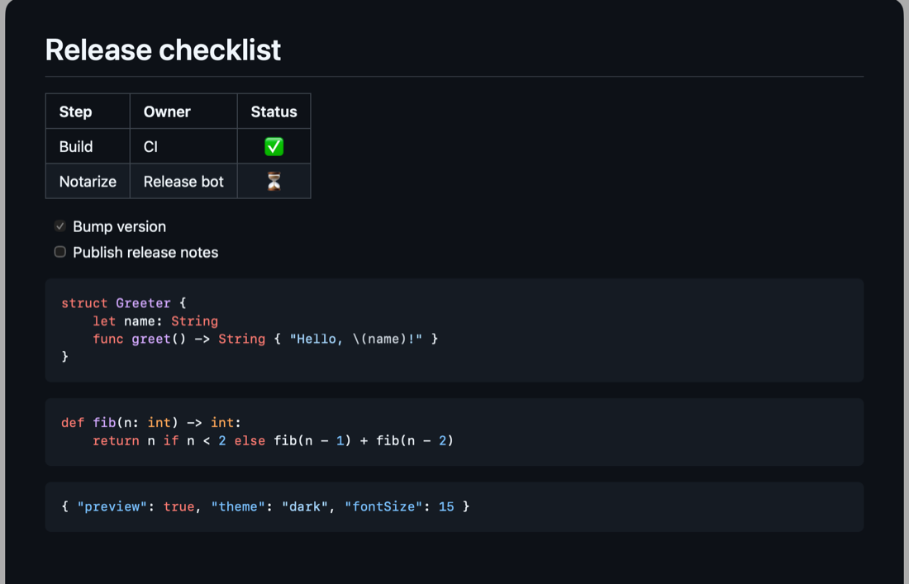

# MarkdownPeek

Quick Look for Markdown on macOS. Select a `.md` file in Finder and press **Space** to see it rendered: GitHub Flavored Markdown, syntax-highlighted code, light and dark mode. Finder icons show a rendered page, too.

<p>
  
  
</p>

## Features

- **Quick Look preview:** tables, task lists, strikethrough, autolinks, footnotes, YAML front matter, and heading anchors (`#links` scroll within the page). Images next to the file are shown, and so are remote `https` images. Links open in your browser.
- **Syntax highlighting** for about 40 languages ([highlight.js](https://highlightjs.org) common set plus Dockerfile, PowerShell, Nginx, Protobuf, Dart, and Scala).
- **Finder thumbnails:** file icons show the top of the rendered document, badged `MD`.
- **Settings app:** theme (Auto/Light/Dark), font size, content width, code highlighting, and front matter, with a live preview.
- **Safe for untrusted files:** the preview runs with JavaScript disabled and a strict Content Security Policy.


## Install

Requirements: macOS 14 or later and Xcode 16 or later.

```bash
git clone https://github.com/<you>/markdownpeek.git && cd markdownpeek
```

```bash
./scripts/install.sh
```

The script:
1. builds a Release copy,
2. installs it to `~/Applications/MarkdownPeek.app`,
3. registers both Quick Look extensions.

Then select a Markdown file in Finder and press Space. Re-run the script after pulling changes.

### Code signing

Quick Look extensions must be signed. On first run, `install.sh` finds the **Apple Development** certificate in your keychain and writes your team ID to `Config/Local.xcconfig`. Git ignores that file, so your team ID never ends up in the repository.

- **No certificate yet?** A free Apple ID is enough. In Xcode, open *Settings › Accounts*, add your Apple ID, then choose *Manage Certificates… › + › Apple Development*. Run the script again.
- **Several teams?** Choose one with `TEAM_ID=ABCDE12345 ./scripts/install.sh`, or edit `Config/Local.xcconfig` (see `Config/Local.xcconfig.example`).
- **Without any certificate**, the build is ad-hoc signed. It compiles, but macOS may refuse to load the extensions.
- **Don't pick a team in Xcode's *Signing & Capabilities* tab.** Xcode writes that choice into `project.pbxproj`, which is committed, and CI rejects any commit that contains a team ID. `Config/Local.xcconfig` is the place for it.

## Troubleshooting

- **Finder still shows plain text.** Open *System Settings › General › Login Items & Extensions › Quick Look* and make sure MarkdownPeek is on. Then relaunch Finder (Option-right-click the Finder icon in the Dock › Relaunch).
- **Thumbnails are still plain text.** The system thumbnail agent caches its list of extensions. Log out and back in, or run `killall -9 com.apple.quicklook.ThumbnailsAgent` (it restarts on demand), then `qlmanage -r cache`.
- **Check registration:** `pluginkit -m -v -i com.markdownpeek.MarkdownPeek.Preview` should print a line starting with `+`.
- **Test without Finder:** `qlmanage -p file.md` opens a preview. `qlmanage -t -x -s 512 -o /tmp file.md` writes a thumbnail.
- **Logs:** `log stream --level info --predicate 'subsystem == "com.markdownpeek"'`.

## Uninstall

```bash
/System/Library/Frameworks/CoreServices.framework/Frameworks/LaunchServices.framework/Support/lsregister -u ~/Applications/MarkdownPeek.app && rm -rf ~/Applications/MarkdownPeek.app && defaults delete com.markdownpeek.MarkdownPeek
```

## How it works

```
MarkdownPeek.app            SwiftUI settings window (not sandboxed)
├─ MarkdownPreview.appex    com.apple.quicklook.preview   (view-based, WKWebView)
└─ MarkdownThumbnail.appex  com.apple.quicklook.thumbnail (offscreen WKWebView snapshot)
```

Rendering (`Shared/MarkdownRenderer.swift`) is plain Swift, shared by all three targets:

1. Read the file (UTF-8 or a detected encoding) and split off any YAML front matter.
2. Parse it with [cmark-gfm](https://github.com/swiftlang/swift-cmark/tree/gfm), using the `table`, `strikethrough`, `autolink`, `tagfilter`, and `tasklist` extensions plus footnotes.
3. Replace each fenced code block with HTML highlighted by **highlight.js running in JavaScriptCore**. This happens before anything reaches the web view.
4. Add GitHub-style heading ids, and inline local images as `data:` URIs.
5. Wrap the result in a page styled with [github-markdown-css](https://github.com/sindresorhus/github-markdown-css) and the highlight.js GitHub themes (`Shared/HTMLTemplate.swift`).

**Security.** Highlighting is done ahead of time, so the web view runs with **JavaScript disabled**. A CSP also forbids scripts, and `tagfilter` neutralises `<script>`, `<iframe>`, and similar tags. Raw HTML in a `.md` file cannot run code.

**Settings sharing.** The host app writes its normal preferences domain (`com.markdownpeek.MarkdownPeek`). The sandboxed extensions read that domain through the `temporary-exception.shared-preference.read-only` entitlement. App Groups would need a provisioning profile, which a locally signed build doesn't have.

**Extension entitlements.**
- `network.client`: WKWebView needs it inside Quick Look, and it allows remote images.
- A read-only file exception for `/`: lets the extensions read images stored next to the Markdown file.

Both are fine for a locally built app, but neither would pass App Store review.

## Development

```
App/                 settings app (SwiftUI)
PreviewExtension/    Quick Look preview controller
ThumbnailExtension/  Finder thumbnail provider
Shared/              renderer, HTML template, settings; Resources/ holds JS and CSS
Tests/               renderer unit tests
Samples/             sample.md, used by the tests and the settings preview
Config/              signing xcconfig (Local.xcconfig is yours, git-ignored)
scripts/             install, asset download, icon generation
```

Open `MarkdownPeek.xcodeproj` in Xcode and run the **MarkdownPeek** scheme (⌘R for the app, ⌘U for tests). To run the tests from the command line:

```bash
xcodebuild -project MarkdownPeek.xcodeproj -scheme MarkdownPeek -destination 'platform=macOS' CODE_SIGNING_ALLOWED=NO test
```

- The project uses **synchronized folders** (Xcode 16+). A file added to `App/`, `Shared/`, `PreviewExtension/`, `ThumbnailExtension/`, or `Tests/` joins its target(s) automatically, with no project-file edit. `Shared/` belongs to all four targets.
- The extensions see your code changes only after `./scripts/install.sh`. Running from Xcode only launches the settings app.
- CI (`.github/workflows/ci.yml`) runs the unit tests unsigned on every push and pull request, and fails if a team ID is committed.
- `scripts/fetch-assets.sh` re-downloads the pinned highlight.js (11.11.1) and github-markdown-css (5.8.1) files.
- `scripts/make-icon.swift` regenerates the app icon.

## License

[MIT](LICENSE) © 2026 Domen Jesenovec. Bundled third-party components (cmark-gfm, highlight.js, github-markdown-css) keep their own licenses; see [THIRD_PARTY_NOTICES.md](THIRD_PARTY_NOTICES.md).
